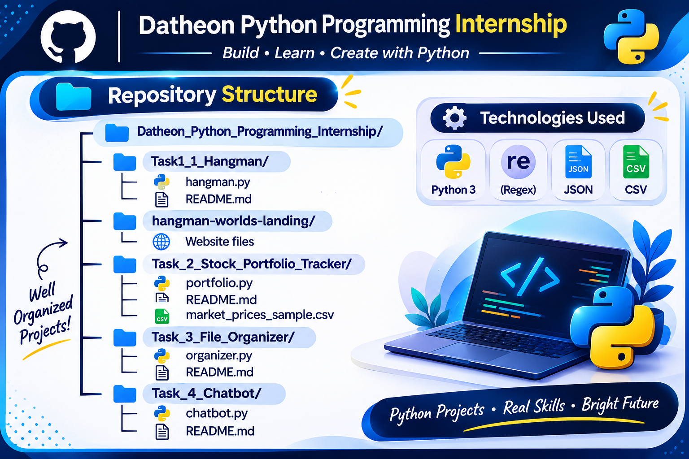

# 🚀 Datheon Python Programming Internship

<div align="center">

### 💻 Building • Learning • Creating with Python

A collection of practical projects developed during my **Python Programming Internship at Datheon**.


</div>

---

## 👩‍💻 About This Repository

Welcome to my internship project repository!

This repository showcases my hands-on learning experience through Python programming tasks and application development. Each project focuses on practical implementation, logical thinking, and building useful applications.

---

## 📂 Repository Structure

<p align="center">
  
</p>
   
---

## 🎯 Internship Projects

### 🎮 Task 1 — Hangman: Python Console Game

A fun, terminal-based Hangman game developed using Python.

**✨ Key Features**
- 🎲 Random word selection from a built-in word bank.
- 💡 Clues and additional hints for secret words.
- ❤️ Six incorrect attempts per round.
- 🎨 ASCII-based Hangman graphics.
- 🔤 Tracks guessed letters and prevents duplicate penalties.
- 🏆 Victory and defeat screens with replay option.

**▶️ Run the project**
```bash
cd Task1_1_Hangman
python hangman.py
```

**📁 Folder:** `Task1_1_Hangman/`

---

### 🌍 Task 1 — Hangman Worlds: Web Game

An interactive browser-based version of Hangman featuring a cartoon fantasy-themed gaming experience.

**✨ Key Features**
- 🗺️ Interactive game interface.
- 🎯 Three difficulty levels: Easy, Medium, and Hard.
- 🔊 Sound and vibration settings.
- 🌙 Light and dark themes.
- 💡 Hint system and game timer.
- 📊 Game results and performance statistics.

<div align="center">

### 🎮 Play the Live Game

[](https://hiteshrigondane.github.io/Datheon_Python_Programming_Internship/)

</div>

**📁 Folder:** `hangman-worlds-landing/`

---

### 📈 Task 2 — Stock Portfolio Performance Tracker

A Python command-line application designed to track stock investments and calculate portfolio performance.

**✨ Key Features**
- 📌 Enter stock ticker symbols.
- 💰 Record purchase price and quantity.
- 📊 Enter current prices or load prices from a CSV file.
- 🧮 Calculate total investment and current portfolio value.
- 📉 Calculate profit or loss.
- 📈 Calculate percentage returns.
- 💾 Save portfolio summaries in CSV format.

**▶️ Run the project**
```bash
cd Task_2_Stock_Portfolio_Tracker
python portfolio.py
```

**📁 Folder:** `Task_2_Stock_Portfolio_Tracker/`

---

## 🛠️ Technologies & Tools

<div align="center">


</div>


## 🌱 What I Learned

- Python fundamentals and problem-solving.
- Working with functions, loops, and conditional statements.
- CSV file handling and data processing.
- Developing interactive web applications.
- Using Git and GitHub for project management.
- Deploying websites using GitHub Pages.

---

### 🗂️ Task 3 — Automated File Organizer and Cleanup Utility

A Python-based utility that automatically organizes files into separate folders based on their file extensions.

**✨ Key Features**

- 📁 Automatically organizes files into category-wise folders.
- 📄 Moves PDF and document files into the Documents folder.
- 🖼️ Organizes JPG and PNG files into the Images folder.
- 📦 Sorts ZIP files into the Archives folder.
- 💻 Supports videos and code files.
- 🔄 Uses Python `os.scandir()` and `shutil.move()` for file operations.
- 🛡️ Handles file permission errors and duplicate filenames.
- 📊 Displays an execution summary showing total files relocated.
- 📝 Generates a log file to record file operations.

▶️ **Run the project**

```bash
cd Task_3_File_Organizer
python organizer.py
```

**📁 Folder:** `Task_3_File_Organizer/`

---

### 🤖 Task 4 — Rule-Based Interactive Terminal Assistant / Chatbot

A Python-based interactive terminal chatbot designed to answer customer support and product-related questions using keyword matching and regular expressions.

## ✨ Key Features

- 💬 Interactive terminal-based conversation.
- 🔍 Identifies user queries using keywords and regular expressions.
- 🕒 Answers questions about business hours.
- 📦 Provides product information and FAQ responses.
- 🧠 Supports multiple-intent matching.
- 🔄 Maintains a simple conversational flow.
- ⚠️ Provides helpful fallback responses for unrecognized queries.
- 👋 Supports exit commands such as `bye`, `exit`, and `quit`.
- 📂 Supports loading FAQ data from a JSON file.
- 🛡️ Includes basic input and error handling.

## 🛠️ Technologies Used

- Python 3
- `re` — Regular Expressions
- `json` — FAQ Dataset Handling

## 📁 Project Structure

```text
Task_4_Chatbot/
│
├── chatbot.py
├── README.md
└── sample_faq.json
```

## ▶️ How to Run

1. Open the project folder in VS Code.
2. Open the terminal.
3. Run the following command:

```bash
python chatbot.py
```

## 💬 Example Interaction

```text
====================================
       CUSTOMER SUPPORT CHATBOT
====================================

Bot: Hello! Welcome to our support assistant.
Bot: How can I help you today?

You: What are your business hours?
Bot: Our business hours are ...

You: Tell me about your products.
Bot: Here is some information about our products ...

You: bye
Bot: Thank you for chatting with us. Goodbye!
```

*Note: Example responses will be finalized during implementation.*

## 🎯 Learning Outcomes

- Understanding rule-based chatbot development.
- Using regular expressions for text processing.
- Implementing keyword-based intent recognition.
- Working with JSON datasets.
- Managing conversational states.
- Handling multiple intents and unknown queries.

---

**Task 4 — Datheon Python Programming Internship**

*Built with Python 🐍*


<div align="center">

## 🙋‍♀️ About Me

**Hiteshri Gondane**

*Python Programming Intern | Engineering Student | Aspiring Developer*

Thank you for visiting my repository! ⭐

If you find these projects interesting, feel free to explore the code and share your feedback.

**Made with ❤️ and Python**

</div>
